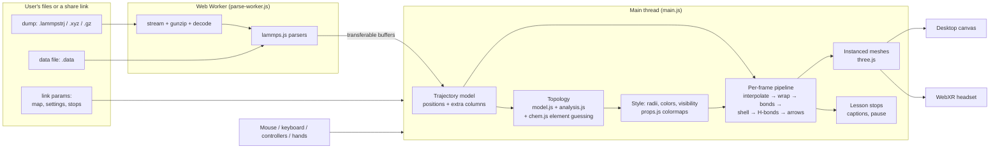
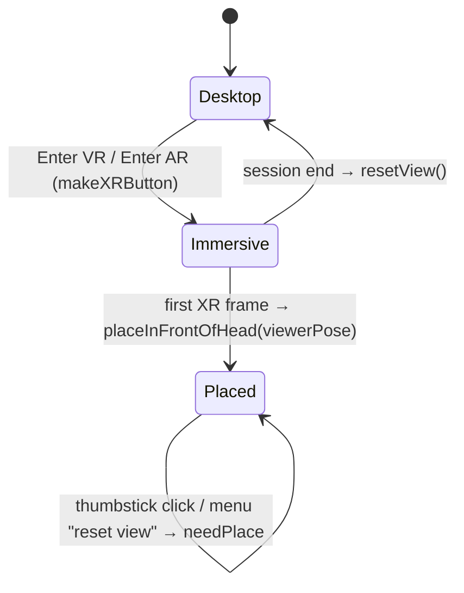
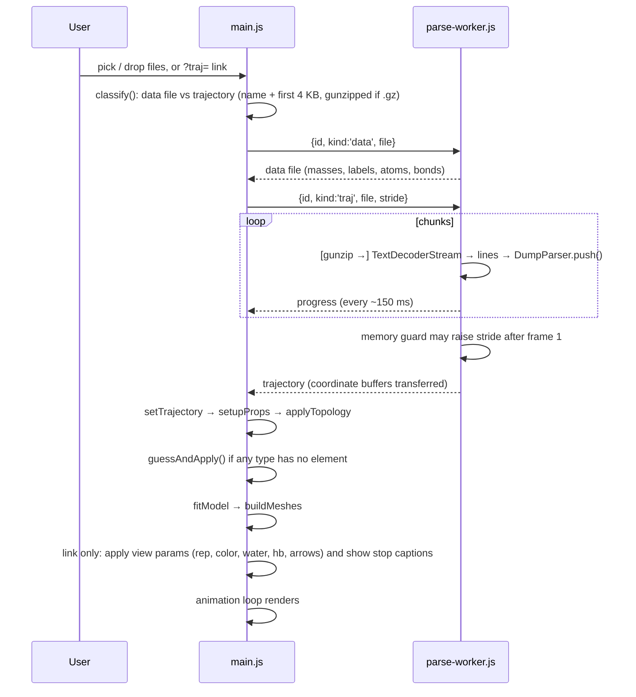

# MD Trajectory VR Viewer: architecture and components

This document explains how the viewer is put together: the third-party technology it
relies on, what each source file does, how data flows from a LAMMPS dump to pixels in a
headset, and the algorithms that handle periodic boundaries. It is written for whoever
maintains or extends the viewer next (for example a student developer or the lab's
research software engineer).

For *using* the viewer, see the [README](../README.md). For *why* it's built on WebXR
rather than VMD, Unity, Godot or Unreal, see [SCOPING.md](../SCOPING.md). To brief a
programmer who has to build it again from scratch (the core, how each feature sits on it,
acceptance numbers and pitfalls), see [REBUILD_BRIEF.md](REBUILD_BRIEF.md).

---

## 1. At a glance

- **What it is:** a static web page (no build step, no server-side code) that reads
  LAMMPS trajectory files in the browser and renders them on a desktop or in a VR headset.
- **Language:** plain JavaScript ES modules (~3,400 lines), with no framework and no bundler.
- **Rendering:** [three.js](https://threejs.org) r169 on WebGL 2.
- **VR:** the browser's [WebXR Device API](https://immersive-web.github.io/webxr/), via
  three.js's WebXR support.
- **Runs on:** Chrome/Edge on a PC (desktop or PC VR via Quest Link, Virtual Desktop or
  SteamVR), and the Meta Quest browser (standalone).
- **Teaching layer:** element guessing for bare dumps, solvation shells, hydrogen bonds,
  coloring and arrows from any dump column, a measurement-over-time plot, and timed
  lesson stops (captions + saved views) shared as links, with a student mode.



---

## 2. Third-party components

All dependencies load at runtime from public CDNs, pinned to exact versions. There is
no `node_modules` and nothing to install.

| Component | Version | Loaded from | Used for |
|---|---|---|---|
| **three.js** core | 0.169.0 | jsDelivr, via the import map in `index.html` | Scene graph, WebGL 2 renderer, `InstancedMesh`, materials, math (vectors, quaternions, matrices), `Raycaster`, `CanvasTexture`, `Sprite` |
| `OrbitControls` (three addon) | 0.169.0 | same | Desktop mouse rotate / zoom / pan |
| `XRControllerModelFactory` (three addon) | 0.169.0 | same; it fetches controller 3D models from the WebXR Input Profiles CDN | Real-looking controller models that match the connected hardware |
| **IWER** (Immersive Web Emulation Runtime, by Meta) | 2.1.1 | jsDelivr `+esm`, only when the URL has `?emulate` | Emulates a Quest 3 (headset and both controllers) in a desktop browser for development and automated testing |

Changing the three.js version means editing the two URLs in the `<script type="importmap">`
block of `index.html`. Addons must always match the core version.

### Browser platform APIs

The viewer leans heavily on standard browser features instead of libraries:

| API | Where | Why |
|---|---|---|
| **WebXR Device API** | `main.js` (through three.js) | Headset pose, stereo rendering, `XRInputSource` controllers and hands, `local-floor` reference space |
| **Gamepad API** (inside WebXR input sources) | `pollGamepads()` | Thumbsticks and A/B/X/Y buttons on Quest/Index controllers, trackpads on Vive wands |
| **Web Workers** (module workers) | `parse-worker.js` | Parse files without freezing rendering |
| **Streams API** + `TextDecoderStream` | `parse-worker.js` | Read multi-GB files chunk by chunk; V8 cannot hold a string larger than ~0.5–1 GB |
| **`DecompressionStream('gzip')`** | `parse-worker.js`, `headText()` in `main.js` | Open `.gz` dumps (e.g. `dump custom/gz`) without a library |
| **Clipboard API**, `TextEncoder` + `btoa` | *Copy share link* | Put a link holding all lesson stops (UTF-8 JSON as base64url) on the clipboard |
| **Transferable ArrayBuffers** | worker → main | Hand over parsed coordinates with zero copying |
| **Canvas 2D** | labels, VR wrist menu | Draw text and UI, uploaded as `CanvasTexture` |
| **File / Blob / DataTransfer** | file picker, drag-and-drop, `?traj=` links | Getting data in |
| **`canvas.toBlob`** | `saveScreenshot()` | PNG export |
| **`localStorage`** | settings block at the top of `main.js` | Remember display preferences (wrapped in `try/catch`, so private windows still work) |

### Development-time tools

| Tool | Used for |
|---|---|
| Python 3 `http.server` | Local static server (`python -m http.server 8137`). WebXR needs `localhost` or HTTPS. |
| Python 3 (`tools/make_sample.py`) | Generates the synthetic parser fixture (trajectory + data file) |
| Node.js (`tools/test_parser.mjs`, `tools/test_features.mjs`) | Runs the parser, geometry and teaching-feature tests; the core modules have no DOM dependencies |

---

## 3. Source files

```
index.html             page layout, styles, control panel, import map
sw.js                  service worker: offline cache for the installed app
manifest.webmanifest   web app manifest (name, icons, standalone display)
icons/                 app icons, drawn by tools/make_icons.py
src/
  main.js              application: scene, loading, rendering loop, all interaction
  parse-worker.js      Web Worker: streams files into the parsers, memory guard
  lammps.js            LAMMPS dump / XYZ / data-file parsers (DOM-free)
  model.js             element resolution, bond inference, radii, box geometry (DOM-free)
  analysis.js          periodic wrapping, measurements, paths, water detection (DOM-free)
  chem.js              element guessing, solvation-shell masks, hydrogen bonds (DOM-free)
  props.js             extra dump columns: vectors, color ranges, colormaps (DOM-free)
  elements.js          element table: colors, radii, masses; color palettes (DOM-free)
tools/
  make_sample.py       synthetic test fixture generator
  make_icons.py        draws icons/icon-192.png and icon-512.png (Pillow)
  build_site.py        copies the hosted app into dist/ (git-ignored); --no-sample
  fixtures/            synthetic.lammpstrj + .data (parser fixture, not physical)
  test_parser.mjs      Node tests: parsers, bonds, wrapping
  test_features.mjs    Node tests: extra columns, gzip, element guessing, H-bonds, shell
samples/               caffeine_water.lammpstrj.gz (real student NPT run) + sample.lesson.json
                       (its guided tour); samples/big/ is git-ignored
```

The six DOM-free modules (`lammps.js`, `model.js`, `analysis.js`, `chem.js`, `props.js`, `elements.js`) are
pure functions over typed arrays. They run unchanged in the browser, the worker and Node,
which is what makes them testable without a browser.

### 3.1 `index.html`: the page

- **Import map**, which maps `three` and `three/addons/` to pinned CDN URLs.
- **Side panel** (`#ui`): header, status line (`#statusBox`), the Explore / Lesson switch
  (`#modeBox`), then collapsible `<details class="sec" data-sec=…>` sections: File (with a
  nested *Atom types and elements* table), Appearance, Water & H-bonds, Select & measure
  (with the plot canvas), Lesson (with a nested *Edit stops and share*), Advanced, and
  Controls & help. Open/closed state is saved under `md-vr-viewer-sections` in
  localStorage. In Lesson mode the Lesson section moves to the top (flex `order`). The `–`
  button collapses the panel. Elements with class `adv` are hidden in student mode
  (`body.student`): File, Advanced and the stop editor.
- **Playback bar** (`#bar`): step, play, frame slider, frame/time, speed, stop buttons
  (Lesson mode with stops only), reset, screenshot, and our own Enter AR / Enter VR buttons
  (`makeXRButton('ar' | 'vr')` in `main.js`: checks `isSessionSupported`, plain-language
  states such as *No headset* with a tooltip on what to do, re-checks on `devicechange`,
  requests the session and hands it to `renderer.xr.setSession`; while one session runs the
  other button is disabled). The AR button stays hidden unless `immersive-ar` is supported.
- **Passthrough.** In an `immersive-ar` session (`arSession`), three.js clears to
  transparent whatever `scene.background` is (`alpha-blend` blend mode), so the room shows
  through. `updateBackdrop()` hides the floor grid then; with `S.passthrough` off it shows
  `backdrop`, a dark back-faced sphere (radius 40 m, drawn first) around the user, which
  looks like VR without ending the session.
- **Caption overlay** (`#caption`) for the active lesson stop.
- **Drop overlay** (`#drop`) for drag-and-drop.
- **CSS** uses a dark theme in custom properties (`--bg`, `--panel`, `--bar-h`, …) and a
  phone breakpoint at 700 px (full-width panel and caption, icon-only stop buttons).

Every control has an `id`, and `main.js` wires them up in its *UI wiring* section.
There is no other coupling between the two files.

### 3.2 `lammps.js`: parsers

Converts text into the **trajectory model** (section 4).

| Export | Purpose |
|---|---|
| `detectFormat(head)` | `'dump'` if the file starts with `ITEM:`, `'xyz'` if it starts with an atom count |
| `createTrajectoryParser(head, opts)` | Returns a **streaming** parser `{ push(line), finish() }` |
| `parseTrajectory(text, opts)` | Convenience wrapper for whole strings (tests, small files) |
| `parseDataFile(text)` | LAMMPS data files: `Masses`, `Atoms`, `Bonds`, type labels |

**`DumpParser`** is a line-driven state machine
(`item → timestep → natoms → box → atoms → item …`) that handles:

- **Coordinate columns**, chosen in order of preference: unwrapped `xu yu zu`, then
  wrapped `x y z` (unwrapped using image flags `ix iy iz` when present), then scaled
  `xs ys zs` / `xsu ysu zsu`, converted to Cartesian with the box matrix (`writePos`).
- **Triclinic boxes.** `ITEM: BOX BOUNDS xy xz yz` lines store the *bounding box*, which
  `parseBox` converts back to the parallelepiped's `lo/hi` and tilt factors (formulas from
  the LAMMPS *Howto triclinic* page).
- **Atom reordering.** LAMMPS doesn't guarantee row order. Frame 1 is sorted by `id`
  (`initAtoms`), and every later row is placed by an `id → index` map. Atoms missing
  from a frame keep their previous position; atoms not in frame 1 are counted in a
  warning.
- **Stride and the memory guard.** `stride` keeps every Nth frame. `onFirstFrame`
  lets the worker raise the stride once it knows atoms per frame and file size.
- **Truncated files.** A partial last frame is dropped with a warning.
- **Extra columns.** Every column that isn't an id, type, element, mol, coordinate or image
  flag (up to 24) is stored per frame as `frame.props[name]` (`Float32Array(n)`), and the
  names are listed in `traj.props`. Velocities, forces, charges and computes all arrive
  this way.

**`XYZParser`** reads `dump xyz` (count line, comment line, then `type x y z` rows). It
takes the timestep from the comment if present, and assumes a constant atom order and
no box.

**`parseDataFile`** walks sections by header name. Atom-style column layouts come from
the `Atoms # full` comment hint, or are guessed from the column count.

### 3.3 `parse-worker.js`: background loading

1. Receives `{ id, kind, file, stride }` from `main.js`.
2. For trajectories, streams the `File` (through `DecompressionStream('gzip')` when it starts
   with the gzip magic bytes) and `TextDecoderStream`, splits the chunks
   into lines (carrying partial lines over to the next chunk), and pushes them into the
   streaming parser.
3. **Memory guard.** After the first frame, it estimates
   `frames ≈ fileSize / charsPerFrame` and the memory needed
   (`frames × atoms × (12 + 4 × extra columns) bytes`, with the file size scaled by the
   compression ratio seen so far for `.gz`). If that exceeds the budget (2 GB desktop, 0.8 GB on
   the Quest browser), it raises the stride and adds a user-visible warning.
4. Posts progress every ~150 ms, then the finished trajectory, with all coordinate
   buffers in the transfer list (zero-copy).

Each request has an `id`, so overlapping loads can't be confused. `main.js` also uses a
`loadSeq` counter so a newer load always wins.

### 3.4 `model.js`: topology and styling helpers

| Export | Purpose |
|---|---|
| `parseTypeMap(str)` | `"1:C 2:H"` / `"1=C, 2 H"` → `{ '1': 'C', '2': 'H' }` |
| `resolveElements(traj, data, userMap)` | An element for every atom. Priority: user map > dump `element` column > data-file type label > data-file mass > type name that looks like an element > `X`. Also returns the per-type summary shown in the *Atom types* table. |
| `resolveMols(traj, data)` | Molecule-IDs from the dump `mol` column, else from the data file |
| `bondsFromData(traj, data)` | Data-file bonds (atom-IDs) → index pairs |
| `inferBonds(pos, elements, opts)` | Distance-based bonds, periodic-aware (section 6.3) |
| `inferStableBonds(frames, elements, opts)` | Runs `inferBonds` on the first, middle and last frames and keeps bonds found in at least 2 (both, with 2 frames), so contacts in an unequilibrated first frame are dropped |
| `atomRadius(el, rep)` | Display radius per representation |
| `boxCorners(box)` | 8 corners of a possibly triclinic box (for the wireframe) |

### 3.5 `analysis.js`: geometry that runs every frame

| Export | Purpose |
|---|---|
| `boxVectors(box)` | Box edge vectors **a**, **b**, **c** |
| `buildGroups(n, bonds, mols)` | Splits atoms into molecules and a BFS order over bonds (section 6.4) |
| `wrapGroups(pos, groups, box)` | Reassembles molecules split by the box edge, then wraps them into the box, in place |
| `minImage(box, dx, dy, dz)` | Minimum-image displacement (triclinic-aware) |
| `atomPath(frames, i)` | Continuous path of one atom across all frames |
| `distance`, `angle`, `dihedral` | Measurements (Å, degrees) |
| `waterGroups(groups, elements)` | Flags molecules that are exactly one O and two H |

### 3.6 `chem.js`: chemistry on positions

| Export | Purpose |
|---|---|
| `guessElements(traj, known)` | Elements for numeric types from bonding geometry (section 6.7) |
| `nearMask(pos, refIdx, candIdx, R, n, box)` | Marks candidate atoms within R of any reference atom (cell list, periodic with a box; grids whichever list is larger); used for the water shell |
| `hbondParticipants(elements, bonds, frames)` | Donor pairs `[h, d]` (H bonded to N/O/F) and acceptors: O, F, and N with a free lone pair (section 6.8) |
| `findHBonds(pos, participants, opts)` | `[h, a]` pairs with H···A ≤ 2.5 Å and D–H···A ≥ 120°, periodic with `opts.box` (section 6.8) |

### 3.7 `props.js`: extra dump columns

| Export | Purpose |
|---|---|
| `vectorFamilies(props)` | Finds 3-component columns: `vx/vy/vz`, `fx/fy/fz`, `mux…`, `omega…`, `angmom…`, `name[1..3]` |
| `propLabel`, `propValues` | Display name and per-frame values of a color key (`p:<column>` or `mag:<family>`) |
| `propRange(frames, key, families, n)` | 2nd–98th percentile range over a sample of all frames; symmetric and diverging for signed columns |
| `colormap(v, range, out, o)`, `gradientCSS` | Viridis (sequential) or blue–white–red (diverging), and the matching CSS legend |

### 3.8 `elements.js`: chemistry data

`ELEMENTS` maps 23 elements common in biomolecular and materials MD (plus the unknown
`X`) to:

- the **Jmol CPK color**;
- the **covalent radius**, used for bond inference;
- the **van der Waals radius**, used for space-filling;
- the **mass**, used to identify elements from data files.

`normalizeElement` accepts `"c"`, `"OW"`, `"HW"` and similar, using the first letter
for force-field type names. `elementFromMass` matches masses within 0.6 amu and treats
13–16 amu united-atom CH*n* groups as carbon. `paletteColor(i)` gives distinct colors
for types and molecules (a 12-color Tableau-style palette, then a golden-angle hue walk).

### 3.9 `main.js`: the application

`main.js` is organized in commented sections, in this order:

| Section | Key functions | Responsibility |
|---|---|---|
| State | `S` object | All mutable app state in one place (trajectory, topology, style, playback, selection) |
| Settings | `saveSettings()` | Load/save display settings in `localStorage` |
| Emulator | top-level `await import(iwer)` | Installs IWER when `?emulate` is present, **before** the VR button checks for XR support |
| Offline app | `navigator.serviceWorker.register('./sw.js')`, `beforeinstallprompt` | Registers the service worker (not for `file:`, `?emulate` or `?nosw`); shows an *Install* button where the browser offers one |
| VR start-up log | `xrLog`, `lastXRFroze`, `xrSafe` | Writes each Enter VR step to localStorage as it happens. If the last try never reached a running session (a frozen page), the next load says which step it reached and the next session asks only for `local-floor` (safe mode; `?xrsafe` forces it) |
| Scene | renderer, camera, `OrbitControls`, `root` / `model` groups | three.js setup (section 5.1) |
| Loading | `classify`, `loadFiles`, `loadSample`, `setTrajectory`, `applyTopology`, `fitModel` | Files → trajectory → topology → meshes |
| View | `resetView`, `placeInFrontOfHead`, `focusAtom`, `simTime` | Camera and system placement; simulated-time formatting |
| Meshes | `buildMeshes`, `buildBondMesh`, `setBonds` | Allocate instanced meshes; grow the bond buffer for reactive mode |
| Styling | `computeStyle`, `updatePropColors`, `updateLegend`, `applyColors`, `setupProps`, `renderTypeTable`, `guessAndApply` | Per-atom radius, color and base visibility; data-column coloring; the element dropdowns and guessing |
| Per-frame geometry | `updatePositions`, `updateHBonds`, `updateArrows`, `onFrameChange`, `writeBondMatrix` | The frame pipeline (section 5.2); stop triggering on integer frame changes |
| Selection | `select`, `computeSeries`, `plotSeries`, `drawPlot`, `pickAction`, `measurementText`, `updateSelectionGeometry` | Up to 4 picked atoms, highlights, measurement lines, the measurement-over-time plot, paths, labels |
| Picking & labels | `pickAtom`, `makeLabel`, `updateLabelPosition` | Analytic ray–sphere picking; canvas-texture label sprite |
| Desktop input | pointer, double-click and key handlers; `saveScreenshot` | Mouse and keyboard |
| UI wiring | `on*` handlers, `setRep`, `setColorBy`, `setWater`, `setHBonds`, `setArrows`, `setShowPaths` | Panel controls ↔ state |
| Lesson stops | `captureStop`, `applyStop`, `setActiveStop`, `renderStops`, `gotoStop`, `shareLink`, `b64enc`/`b64dec` | Captions tied to frames with view + settings; share links (section 6.9) |
| VR input | controller setup, `rayHit`, `updateHover`, `beginGrab`/`updateGrab`, `pollGamepads`, `menu`, `placeWristPanel` | Everything headset-specific (section 7) |
| Loop | `renderer.setAnimationLoop` | Runs every display frame on desktop and in XR |
| Startup | `loadFromParams()` | `?sample`, `?traj=…&data=…&map=…&fs=…&stride=…`, view settings (`rep`, `color`, `water`, `shell`, `hb`, `arrows`), `stops`, `student` |

`window.viewer` exposes state and a few helpers (`select`, `resetView`, `screenOf`,
`menu`, `hands`) for debugging and automated browser tests.

### 3.10 `sw.js`: the offline app

A service worker plus `manifest.webmanifest` make the viewer an installable app that runs
offline (the Quest 3 standalone setup in the README).

- **Install:** caches the app shell (page, modules, manifest, icons, and the sample if the
  host has it) and the pinned CDN files: three.js core, the addons `main.js` imports and
  their dependencies (`GLTFLoader`, `BufferGeometryUtils`, `motion-controllers`), and the
  WebXR input-profile files for Quest 3 Touch Plus controllers plus the generic fallback.
  Each file is fetched separately with `Promise.allSettled`, so a host without the sample
  still installs.
- **Fetch:** app files are **network-first** with a 4 s limit and the cache as the fallback,
  so a new upload is picked up the next time the app opens online. Version-pinned CDN URLs
  are **cache-first**. Every page address (`?sample`, share links) is served the cached
  page when offline. Other same-origin files (e.g. trajectories behind share links) go
  straight to the network and are not cached; files opened from the device never touch it.
- **Versions:** `VERSION` names the cache; bump it when the file list changes, and old
  caches are deleted on activation.
- `tools/build_site.py` copies exactly the shell files into `dist/` for uploading, and
  with `--no-sample` leaves out the students' data and hides *Load sample*.

---

## 4. Data model

### Trajectory (produced by the parsers)

```js
{
  n:        300,                       // atom count
  ids:      Int32Array(n),             // LAMMPS atom-IDs, ascending; index i is THE atom key everywhere
  types:    ['1','2',…],               // type label per atom, as in the file
  elements: ['O', null, …],            // dump "element" column, if any
  mols:     Int32Array(n) | null,      // molecule-IDs, if any
  frames:   [{ timestep, box, pos: Float32Array(3n),
               props: { vx: Float32Array(n), … } }, …],   // extra columns, per frame
  columns:  ['id','mol','type','x',…], // first ATOMS header
  props:    ['vx','vy','vz','q'],      // names of the extra columns kept
  stride:   1,                         // every Nth frame was kept
  warnings: ['…'],
}
box = { lo:[x,y,z], hi:[x,y,z], tilt:[xy,xz,yz], periodic:[bool,bool,bool] }
```

Positions are stored once per frame as `Float32Array` (12 bytes per atom per frame), plus
4 bytes per extra column, so memory grows linearly with *atoms × kept frames × columns*.

### Derived state (`S` in `main.js`)

| Field | Built by | Rebuilt when |
|---|---|---|
| `elements`, `typeSummary` | `resolveElements` | new file, type-map edit |
| `mols` | `resolveMols` | new file |
| `staticBonds`, `bonds` | `bondsFromData` / `inferStableBonds` | new file, type map; `bonds` changes every frame in reactive mode |
| `groups`, `water` | `buildGroups`, `waterGroups` | with topology |
| `isWater`, `soluteIdx`, `waterIdx`, `hb` (donors/acceptors) | `applyTopology` | with topology (`hb` also per frame in reactive mode) |
| `radii`, `colors`, `baseVisible` | `computeStyle` | style, size, coloring, water mode; bumps `styleRev` |
| `visible` | `updatePositions` | `baseVisible` + the solvation shell, when the data frame or settings change |
| `colors` (data coloring) | `updatePropColors` | every new data frame when coloring by a column |
| `families`, `rangeCache` | `setupProps`, `getRange` | new file; ranges computed lazily per color key |
| `hbPairs`, `hbCount` | `updateHBonds` | when `contactKey` changes (data frame, water mode, shell radius, H-bond mode, style) |
| `cur` | `updatePositions` | every frame that changes (`S.dirty`) |
| `sel`, `paths`, `series` | `select`, `computeSeries` | picking, path toggle |
| `stops`, `activeStop` | lesson functions | adding/editing stops, frame changes, links |
| `guessed` | `guessAndApply` | new file with unknown types, *Guess elements* button |

---

## 5. Rendering

### 5.1 Scene graph

```
scene
├── HemisphereLight, DirectionalLight, GridHelper (floor)
├── root            ← what the user grabs; position/rotation/uniform scale (metres)
│   └── model       ← Å coordinates, scaled so the largest box extent = 0.8 m and centred
│       ├── atomMesh     InstancedMesh(Sphere, n)
│       ├── bondMesh     InstancedMesh(open Cylinder, 2 × capacity)
│       ├── boxLines     LineSegments (12 edges)
│       ├── hbMesh       InstancedMesh(open Cylinder, 3 dashes per H-bond), grows as needed
│       ├── arrowMesh    InstancedMesh(shaft + cone, n), only when arrows are on
│       ├── highlights   4 wireframe spheres (selection colors)
│       ├── measureLines LineSegments between selected atoms (always on top)
│       └── pathLines    4 Lines (one per selected atom)
├── label           Sprite (canvas text), follows the last selected atom
├── controller[0,1] ray Line; grip[0,1] controller model (+ wrist menu on the left)
└── hover dots      one small sphere per hand where its ray hits
```

Splitting **root** (user transform, in metres) from **model** (fixed fit transform) means
grabbing, scaling and resetting never touch atom coordinates.

### 5.2 Per-frame pipeline: `updatePositions()`

This only runs when something changed (`S.dirty`: playback, scrubbing or a style change).

1. **Interpolate** between frame ⌊f⌋ and ⌊f⌋+1 for smooth playback, unless a coordinate
   jumps by more than half the box (a periodic wrap), which would make atoms fly across
   the box.
2. **Wrap**: `wrapGroups(cur, groups, box)` (section 6.4).
3. **Reactive bonds** (optional): re-run `inferBonds` when the integer frame changes.
4. **Contacts**, only when `contactKey` (data frame, water mode, shell radius, H-bond mode,
   style revision, reactive bond frame) changes: the solvation-shell visibility mask
   (`nearMask`) and the H-bond list (`findHBonds`), computed from the data frame's own
   positions with the periodic box (so the result is the same however you arrive at a frame).
   During smooth playback the in-between frames reuse them, so these costs are paid once per
   data frame, not per display frame. The dashes themselves follow the displayed positions.
5. **Data coloring:** when coloring by a column, recolor on each new data frame.
6. **Write atom matrices** straight into `instanceMatrix.array` (scale = radius, or 0 when
   hidden; translation = position). This avoids `Matrix4.compose` and is several times faster
   for tens of thousands of atoms.
7. **Write bond matrices.** Each bond is **two half-cylinders**, one from each atom to
   the midpoint, colored like its atom (the classic VMD/PyMOL look with no shader work).
   The cylinder's local Y axis is aligned with the bond using a hand-built orthonormal
   basis. Bonds that are too long (still split by the box edge, or broken) and bonds to
   hidden atoms get zero scale.
8. **H-bond dashes and arrows**: H-bond endpoints follow the current positions (3
   cylinders covering 60% of each H···A distance); arrows read the frame's vector columns
   and are scaled so the 98th-percentile magnitude is 1.5 Å × the length slider.
9. Update the box wireframe, highlights, measurement lines, paths and label.
10. On an integer frame change, `onFrameChange` triggers lesson stops and redraws the
    measurement plot marker.

### 5.3 Performance techniques

- **GPU instancing:** one draw call for all atoms, one for all bonds.
- **Level of detail by system size:** sphere segments 24×16 (<5k atoms), 14×10 (<30k)
  or 8×6 (more).
- **`frustumCulled = false`** on instanced meshes. Their bounding volumes would be stale
  as atoms move, and the system is almost always in view anyway.
- **Dirty flag:** a paused, unchanged scene doesn't rebuild geometry each frame.
- **Analytic picking** (section 6.5) instead of triangle raycasting.
- **Typed-array cell lists** (counting sort, no per-cell objects) for bond inference, the
  water shell and H-bonds, so they are cheap to rebuild per data frame.
- **Contact caching** (step 4 above): shell and H-bond searches run once per data frame.
- Measured on an RTX 4070 Ti SUPER desktop: a 24k-atom system plays at 60 fps (vsync),
  and a 47 MB dump parses in 0.4 s. `updatePositions` costs ~3.5 ms at 24k atoms; with all
  8,160 water–water H-bonds on it costs ~8 ms on a new data frame and ~3.5 ms between
  frames. The 9,192-atom caffeine system with shell + solute H-bonds (periodic) costs ~4.0 ms per new frame
  and ~1.3 ms between frames.

---

## 6. Algorithms

### 6.1 Triclinic box math

LAMMPS boxes are parallelepipeds with edge vectors
**a** = (lx, 0, 0), **b** = (xy, ly, 0), **c** = (xz, yz, lz). Because this matrix is
upper-triangular, converting a displacement to fractional coordinates is a simple back
substitution (`frac()` in `analysis.js`):

```
fz = dz / lz
fy = (dy − fz·yz) / ly
fx = (dx − fy·xy − fz·xz) / lx
```

Every periodic operation below works in fractional coordinates, so orthogonal and
triclinic boxes share one code path.

### 6.2 Unwrapping on read

With image flags: `x_unwrapped = x + ix·a + iy·b + iz·c`. With scaled coordinates:
`x = lo + xs·a + ys·b + zs·c`. Both happen in `writePos` while parsing.

### 6.3 Bond inference with periodic ghosts: `inferBonds`

Two atoms are bonded if `d < 1.2 × (r_cov,i + r_cov,j)`, with an H–H cutoff of 0.85 Å
to stop water hydrogens bonding to each other.

1. **Ghost images.** If the box is periodic, every atom is wrapped into the box
   (`withGhosts`). Atoms within one cutoff of a periodic face get shifted copies (up to 7
   per atom near a corner), each remembering its original index. The margin is measured
   against the box's *perpendicular* widths (volume / |**b**×**c**|, etc.), so tilted
   boxes work.
2. **Cell list.** All points are counting-sorted into cubic cells one cutoff wide (flat
   integer cell keys; a `Map` is used instead for very sparse systems).
3. **Search.** Each *real* atom checks the 27 neighbouring cells. Pairs are stored once
   (`i < j` on original indices) and de-duplicated with a `Set` when ghosts are involved.

This is O(n), with 30k atoms in ~30 ms. Without ghosts, LAMMPS's default wrapped output
loses every bond that crosses the box edge (2.2% of bonds in the 24k-atom water test).

### 6.4 Making molecules whole, then wrapping: `buildGroups` + `wrapGroups`

Goal: never draw a molecule split across the box, but keep every molecule's centre in
the box (no drift with unwrapped coordinates).

- **`buildGroups`** (once per topology) assigns each atom to a group (its molecule-ID,
  or its bond-connected component) and records a **BFS order with a parent** for each
  atom, walking along bonds. Atoms in a molecule with no bonded path hang off the
  molecule's first atom.
- **`wrapGroups`** (every frame):
  1. In BFS order, move each atom to the periodic image closest to its parent (round its
     fractional displacement). Because parents are processed first, the molecule
     reassembles along its own bonds, which works even for polymers longer than half
     the box.
  2. Compute each group's centroid, then shift the whole group by whole box vectors so
     the centroid lies in `[0, 1)` fractional.

In reactive mode the topology isn't trusted, so each atom is wrapped on its own.

### 6.5 Picking: `pickAtom`

The ray (from the mouse via the camera, or from a controller) is moved into **model
space** with the inverse of `model.matrixWorld`. Then each visible atom gets an analytic
ray–sphere test (`t = tca − √(r² − d²)`), and the nearest hit wins. Atoms smaller than
0.35 Å get a 0.35 Å pick radius so hydrogens are easy to hit. This is O(n) per ray,
cheap enough to run for both controllers every VR frame (hover feedback).

### 6.6 Paths and measurements

- **`atomPath`** accumulates minimum-image steps between consecutive frames, so a path
  never jumps across the box. When drawn, the path is offset so it ends exactly at the
  atom's current, possibly wrapped, position. `setDrawRange` reveals it up to the
  current frame.
- **Angle:** `acos` of normalized dot product. **Dihedral:** `atan2` form (stable, signed
  −180°…180°) using the projection of the outer bonds onto the plane perpendicular to
  the central bond.

---

### 6.7 Guessing elements: `guessElements`

For dumps with bare numeric types and no data file (the common "just give me the dump"
case):

1. **Contacts.** Every pair within 1.9 Å in the middle frame (via `inferBonds` with
   generic radii, so periodic images are included). Each contact's length is then
   **averaged over four frames** (¼, ½, ¾ and last) with the minimum image, which cuts
   thermal noise.
2. **Hydrogens, per atom.** An atom with exactly one contact shorter than 1.15 Å is H if
   its partner has ≥ 2 such short contacts (water H, CH₃ H), or if the atom has fewer
   1.15–1.75 Å neighbors than its partner (hydroxyl: the O also bonds to a C). Then a
   majority vote per type.
3. **Heavy atoms, per type.** For each type: the most common H count and heavy-neighbor
   count, plus the type-averaged X–H and X–heavy lengths. Rules: two H and no heavy
   neighbor → water O; X–H < 0.985 Å → O, < 1.05 Å → N, else C (> 1.25 Å → S); no H
   and one neighbor → O (C=O) or N (nitrile, < 1.19 Å); two neighbors → aromatic N
   (< 1.38 Å) or ether O; three neighbors with a bond < 1.30 Å → carbonyl C; four with
   ≥ 3 terminal O → P.
4. **C or N in rings (`resolveByValence`).** Three-coordinate atoms without H can be sp2 C
   or N, and their bond lengths overlap. The function tries every C/N assignment of these
   types (up to 2¹⁰) and keeps those where the unsaturated atoms (C with 3 neighbors, N
   with 2, O with 1) have a **perfect matching** over bonds, i.e. a Kekulé structure exists
   (found with augmenting paths). Among valid assignments it prefers N next to methyl
   groups and fewer N overall. On caffeine this picks out exactly the three N–CH₃
   nitrogens.

Each guess gets a confidence: low when atoms of a type disagree, a fallback rule fired,
or several valence assignments were valid. The *Atom types* table shows *guessed* or
*guessed ?* with the reason as a tooltip.

### 6.8 Hydrogen bonds and the water shell

Both use a uniform cell list (`buildGrid` in `chem.js`: counting sort into typed arrays,
like `inferBonds`) periodically, on the data frame's positions:

- **Cell list** (`buildGrid`): with a periodic box, cells tile the box in fractional
  coordinates, as many per box vector as fit with a perpendicular width ≥ the cutoff, and
  neighbor cells wrap around (with fewer than 3 cells along a vector, all are visited once).
  Distances use the minimum image (`makeDelta`: inline for orthogonal boxes, `minImage` for
  triclinic). Without a box, cells cover the atoms' bounding box. Counting sort into typed
  arrays, preallocated neighbor spans: no allocations per query.
- **Shell:** a water molecule is shown if any of its atoms is within R of a solute atom.
  `nearMask` grids whichever list is larger and queries the smaller (192 caffeine atoms
  against 9,000 water atoms: grid the water). For pure water there is no solute, so the
  *Near solute* option is disabled.
- **H-bonds:** grid the acceptors with cell size 2.5 Å; for each donor hydrogen test
  H···A ≤ 2.5 Å and cos∠(D–H···A) ≤ cos 120°. `updateHBonds` narrows the candidates first:
  only shown atoms, and for *with solute* two searches (any donor → solute acceptors, solute
  donors → water acceptors) instead of filtering every water–water contact afterwards.
  Bonds across the box edge are drawn toward the acceptor's nearest image.
- **Acceptors** (`hbondParticipants`): every F, O with at most 2 bonds (3-bonded O such as
  H₃O⁺ is skipped), and N only when its lone pair is free. N with 4 bonds (ammonium, NH₃⁺) is skipped. N with 3 bonds is skipped when planar:
  its distance from the plane of its three neighbors, averaged over the first, middle and
  last frames (current frame in reactive mode), is under 0.2 Å. Amide, aromatic and
  methylated ring N (caffeine's N1/N3/N7) are planar, and amines are pyramidal (about 0.35–0.45 Å).
  N with 1–2 bonds (pyridine-like, caffeine's N9) accepts. Each H-bond is drawn as three short cylinders (an
  `InstancedMesh`), because one-pixel dashed lines nearly vanish in a headset.

Both searches run only when the data frame or a relevant setting changes (`contactKey`,
section 5.2); see section 5.3 for timings.

### 6.9 Lesson stops and share links

A stop is `{ f, cap, sel: [atom-IDs], v: { rep, color, water, shell, hb, arrows, paths }, cam }`.

**Modes.** `S.mode` is `'explore'` or `'lesson'` (`setMode`, which also sets `body.mode-*`
classes that show or hide the Lesson section, the caption and the stop buttons). In Explore,
`onFrameChange` returns before any stop logic, so nothing overrides the user. Entering
Lesson applies the latest stop at or before the current frame (`applyStop(k, {playback:
true})`, no frame jump). Loading stops (the sample tour or a link) selects Lesson; opening a
local file after the sample's tour selects Explore; `gotoStop` switches to Lesson.
`cam` holds the camera position and orbit target in **model coordinates**, so it survives
a refit or window resize. Stops are kept sorted by frame.

- `onFrameChange` runs when the integer frame changes. While playing forward (or after
  playback wraps, tracked by `S.looped`) it finds a stop crossed since the previous frame,
  applies it and optionally pauses. The caption shown is always the latest stop at or
  before the current frame.
- `shareLink` writes the file URL(s), mapping, settings and `stops` (JSON →
  UTF-8 → base64url, so captions in any language survive) into the query string.
  `loadFromParams` reverses this; view settings are applied after the trajectory loads
  because coloring and arrow choices depend on its columns.

## 7. VR interaction layer



| Piece | How it works |
|---|---|
| **Controllers** | `renderer.xr.getController(k)` (targetRay space: rays, select/squeeze events) and `getControllerGrip(k)` (grip space: 3D model, wrist menu). `connected` events give the `XRInputSource` (handedness, gamepad, hand). |
| **Placement** | On session start, reads the `XRViewerPose` directly from the `XRFrame` (reliable on the first frame) and puts `root` 0.75 m in front of the head along the horizontal look direction, 15 cm below eye level, rotated to face the user. |
| **Grab (one hand)** | On `squeezestart`, stores `offset = inverse(controller) × root`; each frame sets `root = controller × offset`. The system moves rigidly with the hand. |
| **Grab (two hands)** | Stores the initial hand distance, the hand-to-hand direction and the root point under the midpoint. Each frame, scale = s₀·d/d₀, rotation = (quaternion turning the old hand-to-hand direction into the new one) × q₀, and the position keeps the same root point under the midpoint. |
| **Wrist menu** (`menu`) | An 800×880 canvas on a 20×22 cm plane, attached to the left grip (or the only controller) and turned toward the head every frame (`faceHead` → `lookAt`). It's rendered double-sided so rays from either side register. Layout: title, status, selection, timeline (with yellow stop ticks), an info panel (in Lesson mode the active stop's caption at the largest of 26/23/20 px that fits, about 250–450 characters; otherwise the measurement plot, which also scrubs), a transport row (step, play, step, reset), the Explore | Lesson segmented switch (narrowed in AR sessions to fit the *room: on/off* passthrough toggle, `MODES_AR`), and a 2×4 grid whose buttons depend on the mode (`GRID.explore` / `GRID.lesson`). `visibleButtons()` feeds both drawing and `hitTest(uv)`, which maps the ray's UV hit to a button or timeline position; `press()` performs the action. Steppers such as atoms −/+ go through `nudge(id, d)`, which sets the page control and fires its `input` event, so desktop and VR stay in sync. The canvas is redrawn only when a key of the displayed state changes. |
| **Ray priority** | `updateHover` raycasts the menu first (three.js `Raycaster` against one plane), then atoms. While a ray is on the menu, the trigger never picks atoms behind it. Holding the trigger on the timeline scrubs. |
| **Gamepad shortcuts** | `pollGamepads` reads `gamepad.buttons` (xr-standard mapping: 0 trigger, 1 squeeze, 2 touchpad press, 3 thumbstick press, 4 A/X, 5 B/Y) and `axes[2..3]` (thumbstick). Controllers without a thumbstick (Vive wands: 3 buttons, 2 axes) use the touchpad `axes[0..1]` while it is touched, and its press for reset. Edges are detected against the previous frame. |
| **Hand tracking** | Requested as an optional feature. A pinch fires `select`/`squeeze` like a controller, and the laser is hidden for hands. |
| **Emulation** | With `?emulate`, IWER replaces `navigator.xr`. Tests then drive `xrDevice.controllers.right.position / quaternion / updateButtonValue / updateAxes`, exactly like a real Quest. |

---

## 8. Loading pipeline in detail



---

## 9. Testing


| Layer | How | Command |
|---|---|---|
| Parsers, topology, geometry | `tools/test_parser.mjs`: Node + `assert` on the synthetic fixture (`tools/fixtures/`) and hand-built edge cases. Covers frame/ID ordering, image-flag unwrapping, scaled and triclinic coordinates, XYZ, stride, streaming, the memory-guard stride, truncated files, groups and water detection, repairing 1,566 split bonds, continuous paths, triclinic minimum image, measurements, periodic and triclinic bond inference, and 30k-atom bond-inference speed. | `node tools/test_parser.mjs` |
| Desktop UI | Browser checks through `window.viewer` (`screenOf(i)` converts an atom to screen pixels for real clicks) | manual / scripted |
| Teaching features | `tools/test_features.mjs` (see below) | `node tools/test_features.mjs` |
| VR | IWER emulator with scripted controller poses and buttons. Verified: placement, the menu (play, step, timeline, style, color, water, paths, and after the lesson update: the third button row, next-stop, caption and plot panel; after the UI update: the Explore/Lesson switch both ways, next stop, atoms +, water, play/pause, all by aiming the controller and pulling the trigger), atom picking and occlusion, one-hand grab (exact translation), two-hand scale (exact ×2), A button, stick scrub, stick-click reset. | open `/?sample&emulate` |
| Lessons and links | Browser checks: stops pause playback at the right frame, a copied share link restores mapping, settings and stops in student mode | manual / scripted |
| Offline app | Browser check on a `dist/` build (launch config `viewer-dist`): the service worker caches all 26 files; with the server stopped, the page, three.js, the sample and its tour load; a gzipped dump (renamed, and without `.gz`), a plain dump with a data file, and XYZ all open from the file input | manual / scripted |
| Real headset | Not yet done | see README |

`tools/test_features.mjs` covers the teaching features on a hand-built water dimer: extra
columns and vector detection, diverging ranges, a gzip round-trip through
`DecompressionStream`, element guessing, exactly one H-bond in a linear dimer and none
when bent, the shell mask, and the acceptor rule (planar, pyramidal, 4-bonded and
2-bonded N). On the bundled caffeine sample, guessing gets all 26 types right (this map is
built into `loadSample`). The tour's numbers (box size and density, shell size, H-bonds per
acceptor) were computed from the data with these modules, periodically, over the
equilibrated frames 12–51 only; the viewer reproduces the per-frame counts exactly (333
shell waters at frame 21, 25 solute H-bonds at frame 26). Periodic contact tests cover
orthogonal and triclinic boxes, an image shifted by a lattice vector, boxes too small for
3 cells, and both search directions of `nearMask`.

`tools/make_sample.py` makes the synthetic fixture (`tools/fixtures/synthetic.*`): 90 waters and 3 glycines in an
18 Å box, 120 frames, with shuffled rows, wrapped coordinates and image flags, numeric
types and a data file with masses and bonds. It's built to exercise the parser, not to
be physically realistic.

---

## 10. Extending the viewer

| Task | Where to change |
|---|---|
| Use another per-atom dump column | Nothing to do: every unknown column is already kept (`frame.props`) and offered under *Color by*. New 3-component families go in `vectorFamilies` (`props.js`) to get arrows and a magnitude. |
| New fixed coloring mode (e.g. by residue) | Add an `<option>` to `#colorBy`, a branch in `computeStyle`, and a name in `COLOR_NAMES` (the VR menu and left stick cycle through all `#colorBy` options automatically) |
| New colormap | A stop table in `props.js` and a branch in `colormap` / `gradientCSS` |
| Another element-guessing rule | `guessElements` in `chem.js` (per-type features are in `feat`); add a case to `tools/test_features.mjs` |
| Something else saved in lesson stops | `captureStop` / `applyStop` in `main.js` (the `v` object), plus a link parameter in `shareLink` / `loadFromParams` if it should also be a top-level setting |
| Hide another control in student mode | Add `class="adv"` to it in `index.html` |
| New representation | Option in `#rep`, a radius rule in `atomRadius`, a bond radius in `updatePositions`, and an entry in `REPS` / `REP_NAMES` |
| New VR menu button | Add `[id, labelFn]` to `GRID.explore` and/or `GRID.lesson` in `menu` (2×4 each; more needs a third row, so the canvas `H` and footer positions grow), a `case` in `menu.press`, and an `enabled` rule if it can be unavailable |
| New element | Add a row to `ELEMENTS` in `elements.js` (color, covalent and vdW radii, mass) |
| Another file format (e.g. PDB, DCD) | A new parser class with `push(line)` / `finish()` that returns the trajectory model; register it in `detectFormat` / `createTrajectoryParser`. Binary formats like DCD need a byte-level reader in the worker instead of the text-line path. |
| Very large trajectories | Replace "all frames in memory" with a preprocessed binary file plus on-demand frame loading; the per-frame pipeline only needs `frames[i].pos` for the current and next frame |

### Conventions

- **Atom index `i`** (sorted by atom-ID) is the only key used across modules. Convert to
  and from LAMMPS IDs only at the edges (parsing, display, data-file bonds).
- **Bonds** are a flat `Int32Array` `[i0, j0, i1, j1, …]`.
- **Positions** are flat `Float32Array` `[x0, y0, z0, x1, …]` in Å. Only `root` and the
  scene are in metres.
- Any state change that affects geometry sets `S.dirty = true`. The animation loop does
  the rest.
