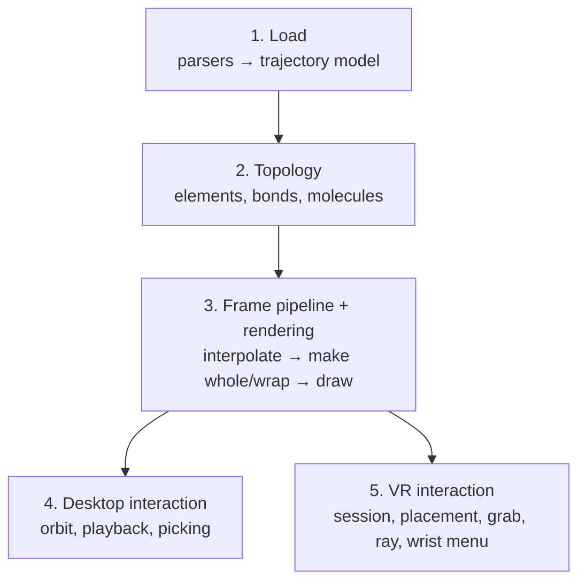
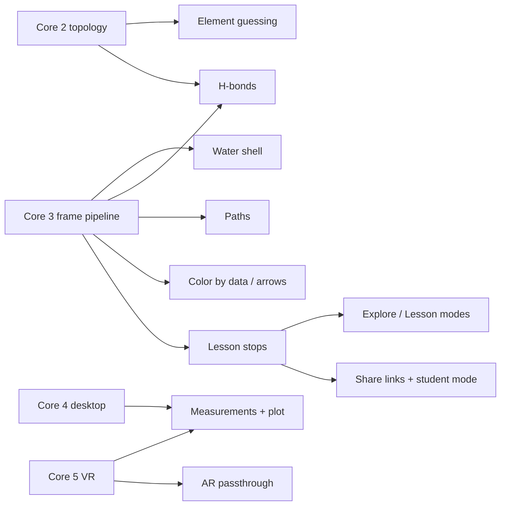

# Rebuild brief: how to ask a programmer to duplicate this project

This is the brief you would hand to a developer who has to build this viewer again from
scratch, in another lab or another language. It tells them what to build, which part is the
core everything else depends on, how each feature sits on that core, and how to tell that
their version is right. It does not repeat the implementation details. Those are in
[ARCHITECTURE.md](ARCHITECTURE.md), and the user-facing behavior is in the
[README](../README.md).

---

## 1. The ask, in one paragraph

> Build a web page that opens LAMMPS molecular-dynamics trajectories (`dump` files, with an
> optional data file) entirely in the browser, and plays them as a 3D movie on a laptop and
> in a VR headset (Quest, Vive and other SteamVR headsets, with optional AR passthrough on
> Quest). Biology students must be able to load a run, play it, grab and turn the system
> in VR, pick atoms, and measure distances and angles over time. Add a teaching layer:
> show the water around a solute, draw hydrogen bonds, color atoms by any dump column,
> and let an instructor record a guided tour (captions tied to frames, with saved views)
> that students open from a single link. It must be a static page: no install, no build
> step, no server code, and the data never leaves the user's machine.

## 2. Who it is for

| User | Needs |
|---|---|
| **Student** (biology, little MD background) | Open a link, press play, look around in VR, follow captions. Should never see file formats, type maps or expert options. |
| **Instructor / TA** | Load their own runs, fix element assignments, set up views, write a tour, share it as a link. |
| **Maintainer** (student developer or research software engineer) | Plain code without a framework, testable without a browser, documented. |

## 3. Hard constraints

Give these to the programmer as requirements, not suggestions:

1. **Static web page.** Plain JavaScript ES modules, loaded straight by the browser. No
   bundler, no `npm install`, no backend. It runs from `python -m http.server` and from any
   HTTPS static host. Libraries come from a CDN, pinned to exact versions (we use three.js
   0.169 through an import map).
2. **WebXR for VR.** One code base for desktop, PC VR (Chrome/Edge on any OpenXR runtime:
   Quest Link, Virtual Desktop, SteamVR) and the standalone Quest browser. WebXR only runs on
   `https://` or `localhost`.
3. **Real LAMMPS output, not cleaned-up files.** Numeric atom types, rows in any order,
   wrapped coordinates with or without image flags, scaled coordinates, triclinic boxes,
   gzip, truncated last frames, multi-GB files.
4. **Periodic boundaries are correct everywhere.** Bonds, molecules, measurements, paths,
   the water shell and H-bonds all use the minimum image, in orthogonal *and* triclinic
   boxes. This was the most common source of bugs; see section 8.
5. **Comfortable in a headset.** 72–90 fps on a Quest-class device for systems of about
   10k atoms. No per-frame allocations in hot loops. Nothing that relies on hover tooltips
   or one-pixel lines.
6. **The science is checkable.** Every rule (bond cutoffs, H-bond geometry, acceptor
   rules) is documented, and every number in a shipped lesson can be reproduced by a
   test script.

## 4. The core

These five layers are the core. Each feature in section 5 plugs into them, and nothing
works without them. Build them in this order; each has a check that should pass before
moving on.



### Core 1: Load files into one trajectory model

- **Ask for:** streaming parsers for `dump custom` / `dump atom`, `dump xyz` and LAMMPS
  data files, running in a Web Worker so the page never freezes. Gzip is decompressed in
  the stream. Parsed coordinates come back as transferable typed arrays.
- **The contract** every later layer relies on (keep this exact shape; it decouples
  everything else from file formats):

  ```js
  { n, ids: Int32Array(n) /* sorted */, types: [...], elements: [...] | null,
    mols: Int32Array(n) | null,
    frames: [{ timestep, box: { lo, hi, tilt, periodic }, pos: Float32Array(3n),
               props: { colName: Float32Array(n), ... } }],
    props: ['vx', ...], stride, warnings: [...] }
  ```

- **Rules:** atom index `i` (rows sorted by atom ID) is the only key anywhere in the app.
  Convert scaled and image-flag coordinates to unwrapped Cartesian while parsing. Keep every
  unknown column (up to 24) per frame. Estimate memory after frame 1 and raise the frame
  stride automatically if the run will not fit (we use 2 GB desktop, 0.8 GB Quest).
- **Done when:** shuffled rows, image flags, scaled and triclinic coordinates, stride,
  truncation and a gzip round-trip all have passing Node tests.

### Core 2: Topology (what each atom is and what it is bonded to)

- **Ask for:** an element for every atom, a bond list, and molecules.
  - Element priority: user's type map > dump `element` column > data-file type label >
    data-file mass > type name that looks like an element > unknown.
  - Bonds: from the data file if it has them; otherwise distance-based
    (`d < 1.2 × (r_cov,i + r_cov,j)`, H–H cutoff 0.85 Å), searched with a cell list and
    periodic ghost images. Run on the first, middle and last frames and keep bonds seen in
    at least two, so an unequilibrated start doesn't create fake bonds.
  - Molecules: from `mol` IDs, else bond-connected components; flag water (exactly 1 O + 2 H).
- **Done when:** bonds that cross the box edge are found (without periodic images,
  LAMMPS's default wrapped output loses about 2% of bonds in a 24k-atom water box), and 30k
  atoms infer bonds in tens of milliseconds.

### Core 3: Frame pipeline and rendering

- **Ask for:** a pipeline that runs only when something changed (a dirty flag), in this order:
  1. interpolate between data frames for smooth playback (except across a periodic jump);
  2. make molecules whole along their bonds, then shift each molecule so its center is in
     the box;
  3. compute contacts (shell, H-bonds; Feature list below) once per *data* frame;
  4. write instance matrices for atoms and bonds straight into typed arrays.
- **Rendering:** three.js `InstancedMesh`: one draw call for all atoms, one for all bonds
  (each bond = two half-cylinders colored like their atoms). Sphere detail drops with system
  size. The scene splits into `root` (the user's grab transform, in metres) and `model`
  (atoms in Å, fitted so the box is 0.8 m), so grabbing never touches coordinates.
- **Done when:** the 9,192-atom sample plays smoothly, no molecule is ever drawn split
  across the box, and a paused scene does no geometry work.

### Core 4: Desktop interaction

- **Ask for:** orbit / zoom / pan, a playback bar (step, play, scrub, speed), analytic
  ray–sphere picking (small atoms get a minimum pick radius), selection of up to 4 atoms,
  keyboard shortcuts, screenshot, and a side panel of collapsible sections. Remember display
  settings in `localStorage`.
- **Done when:** clicking a hydrogen in a dense system selects that hydrogen.

### Core 5: VR interaction

- **Ask for:**
  - **Our own Enter VR button** with plain-language states (*No headset*, *VR needs
    https*), and re-checking when a headset connects.
  - **Placement:** on the first XR frame, put the system 0.75 m in front of the head, just
    below eye level.
  - **Grabbing:** one-hand grab moves the system rigidly; two-hand grab scales and rotates it.
  - **Selection:** a controller ray picks atoms (menu hits take priority over atoms behind it).
  - **Wrist menu:** a canvas texture on the left controller, always turned toward the
    eyes, with playback, a timeline, and the main toggles. Every menu action must call the
    same function as the desktop control, so the two never disagree.
  - **Gamepad shortcuts:** thumbstick controllers (Quest, Index) and touchpad controllers
    (Vive wands, detected from the WebXR input profile names) both need a mapping.
  - **Development without a headset:** load Meta's IWER emulator behind `?emulate`.
- **Done when:** in the emulator, scripted controller poses can grab (exact translation),
  scale (exact ×2), pick atoms and press every menu button.

## 5. Features on top of the core

Each feature names the core layer it plugs into and what "right" means. Build them in any
order after the core; the table goes roughly from most to least important for teaching.

| Feature | Plugs into | What to ask for | Acceptance check |
|---|---|---|---|
| **Element guessing** | Core 2 | For bare numeric types with no data file: guess H from short X–H contacts, O/N/C from X–H length and coordination, and C vs N in rings by requiring a Kekulé structure (perfect matching over unsaturated atoms). Show confidence; let the user override each type in a table. | All 26 caffeine-in-water types come out right with no hints. |
| **Measurements + plot** | Core 4/5 | 2–4 picked atoms give a live distance / angle / dihedral (minimum image), plus a plot over the whole run that also works as a timeline. | Values match a hand calculation; dihedral is signed −180…180°. |
| **Atom paths** | Core 3 | Trails of selected atoms built from minimum-image steps, revealed up to the current frame. | A path never jumps across the box. |
| **Water display + solvation shell** | Core 3 step 3 | Show all water, only water within R Å of a non-water atom (periodic cell list, once per data frame), or none. | Sample, display frame 21: 333 shell waters at R = 4 Å; matches brute force. |
| **Hydrogen bonds** | Core 2 + Core 3 step 3 | H···A ≤ 2.5 Å and D–H···A ≥ 120°, periodic. Donors: H on N/O/F. Acceptors: F; O with ≤ 2 bonds; N only with a free lone pair (skip 4-bonded N and planar 3-bonded N). Modes: off / with solute / all. Draw as 3D dashes, not lines. | Linear water dimer: exactly 1; bent: 0. Sample, display frame 26: 25 solute H-bonds. |
| **Color by data, arrows** | Core 1 `props` + Core 3 | Any extra column or vector magnitude on viridis (blue–white–red when signed), 2nd–98th percentile range, legend; 3-component columns (`vx vy vz`, `fx…`, `c_x[1..3]`) as auto-scaled arrows. | One outlier doesn't wash out the colormap. |
| **Lessons (stops)** | Core 3/4/5 | A stop = frame + caption + selection + display settings + camera (in model coordinates). Playing forward past a stop applies it and can pause. | Stops fire at the right frame, forward and after looping. |
| **Explore / Lesson modes** | Lessons | Explore: stops never fire. Lesson: stops fire and captions show. A visible switch on desktop and in VR, and a "save this moment as a stop" shortcut. | A student who wanders off in Explore is put back on track when returning to Lesson. |
| **Share links + student mode** | Lessons, Core 1 | Everything (file URLs, type map, settings, stops as base64url UTF-8 JSON) in one URL; `student` hides loading and expert controls. | A copied link restores the scene exactly in a fresh browser. |
| **AR passthrough** | Core 5 | *Enter AR* only where `immersive-ar` is supported; the room shows through, and a wrist-menu toggle switches to a dark backdrop without leaving the session. | Hidden on desktop and SteamVR; on Quest the floor grid disappears in AR. |
| **Installable offline app** | All (packaging) | A web app manifest, icons and a service worker that caches the app, its CDN libraries and the headset's controller models, so it installs on a Quest 3 and runs with no PC or network. App files network-first (updates arrive), pinned CDN files cache-first. | With the server stopped, the app and the sample load, and local files open. |
| **Large files** | Core 1 | Streamed parsing (files bigger than a JS string), automatic stride from the memory estimate, progress. | A multi-GB dump loads with a stride warning instead of crashing. |
| **Reactive bonds** | Core 2/3 | Optional bond re-inference every frame for ReaxFF. | Bonds break and form during playback. |



## 6. Deliverables to ask for

1. The page and its modules, with a strict split: **DOM-free modules** (parsing,
   topology, geometry, chemistry, colormaps) that run unchanged in the browser, the worker
   and Node, and **one app module** for the scene, UI and VR.
2. **Node test scripts** for the DOM-free modules (no browser needed), plus a synthetic
   fixture generator that produces the awkward cases on purpose: shuffled rows, image
   flags, numeric types.
3. **A real sample with a guided tour**, every number in its captions reproduced by a script.
4. **Documentation:** a README for users, an architecture document for maintainers, and
   the scientific rules (cutoffs, criteria) written down.
5. **A `?emulate` mode** so VR can be developed and tested without a headset.

## 7. How to check their version

- **Numbers on the bundled sample** (8 caffeine in 3,000 waters, 51 frames, NPT):
  - The box shrinks from 50.0 to about 44.4 Å (density 0.73 → about 1.06 g/cm³).
  - All 26 atom types are guessed correctly.
  - Display frame 21 has 333 shell waters (R = 4 Å); display frame 26 has 25 solute H-bonds.
  - Over frames 12–51: O2 accepts about 1.2 H-bonds, O6 about 1.0, N9 about 0.3, and the
    methylated N none.
- **Performance** (our desktop numbers, for comparison):
  - Parsing: a 47 MB dump in 0.4 s.
  - Frame pipeline: about 4 ms per new data frame with shell + solute H-bonds on 9k atoms;
    24k atoms play at 60 fps.
- **VR:** scripted IWER tests pass, and then someone tries it on every headset the class
  will use. Our version has not been tried on real hardware yet.

## 8. Pitfalls to warn them about

These cost us real time. Put them in the brief so the next programmer avoids them:

- **Periodic boundaries, everywhere.** Our first H-bond and shell code ignored contacts
  across the box edge and undercounted the shell by about 10%. Use the minimum image in
  every distance, in fractional coordinates so triclinic boxes work too.
- **The first frame lies.** An unequilibrated start has overlapping atoms; inferring bonds
  from frame 1 alone creates fake bonds. Use several frames.
- **Compute contacts from data frames, not interpolated ones.** Otherwise a count changes
  depending on how playback reached the frame.
- **Rows are not in order** between frames in LAMMPS dumps; match by atom ID.
- **Browsers can't hold huge strings** (about 0.5–1 GB in V8). Stream line by line.
- **Lone pairs matter** for H-bond acceptors. Amide, aromatic and methylated ring N are
  planar and don't accept; checking planarity over several frames separates them from amines.
- **Thin lines vanish in a headset.** Draw H-bonds and the like as 3D geometry.
- **three.js clears to transparent in AR** whatever the background, so "passthrough off" needs
  real geometry (we use a dark sphere around the user).
- **Vive wands have a touchpad, not a stick.** Tell controllers apart by the input
  profile names, not by counting buttons.
- **A hidden browser window stops XR frames**, so automated VR tests need a visible window.

## 9. Out of scope (for now)

Recorded voice narration, video export, multi-user or instructor-driven sessions, PDB/DCD
input, and on-demand frame streaming for runs that don't fit in memory. Ask for them as
separate projects if needed.
